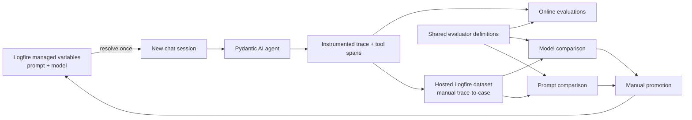

# Applicant Support Logfire Evaluation Loop Design

## Intent

Turn the existing applicant-support baseline into a local demonstration of a complete
agent-improvement loop: observe a live conversation, evaluate it online, turn traces into
reusable dataset cases, compare model and prompt variants in experiments, and promote the
winning prompt and model through Logfire managed variables without redeploying the app.

The demo should make one intentional weakness easy to expose: with a weak prompt or model,
the agent may fail to call `get_application_status` for an applicant lookup and instead give
an unhelpful refusal. The exact case set and rubrics can evolve while the demo is used.

## Demo walkthrough

1. Open the applicant-support UI and start a new session. The first turn resolves the active
   system prompt and Gateway model from Logfire managed variables.
2. Ask several applicant questions. Open the corresponding Logfire traces and inspect the
   evaluations attached to the agent runs: response presence, frustration handling,
   professionalism, factual grounding, and tool-use appropriateness.
3. In Logfire Live View, select a useful agent-run span, use the database-plus action to add
   it to the existing hosted dataset, review the extracted input, expected output, and
   metadata, and save it as a new case. The case retains a link to its source trace.
4. Launch or open the prepared model-comparison experiments. Compare the same prompt and
   dataset using two Gateway models side by side.
5. Launch or open the prepared prompt-comparison experiments. Compare two prompt variants
   while holding the Gateway model fixed.
6. Open Managed Variables and inspect the currently promoted prompt and model. If the
   experiments identify a better configuration, update the variables manually.
7. Start a new applicant-support session and confirm the promoted configuration is resolved
   without restarting the app. Use the Agents view to inspect online evaluation trends over
   the manually generated traffic.

## Current state

- The FastAPI app, SQLite sample data, three agent tools, browser chat, and eight-case local
  `pydantic_evals` dataset already exist.
- Logfire is configured before agent construction and Pydantic AI instrumentation already
  emits the `invoke_agent` spans required by the Agents view.
- The current UI chooses a model per request, the agent instruction is hard-coded, the eval
  runner uses only expected-output prose, and there is no online evaluation capability.
- The `duncan/applicant-support` Logfire project currently has no telemetry, managed
  variables, or managed prompts.
- The installed Logfire SDK is 4.41.0 and Pydantic AI/Evals are 2.43.0. Managed variables are
  available in the SDK, but this workspace still needs the `logfire[variables]` dependency
  extra.
- The current Logfire MCP connection can create and update managed variables and prompts. It
  has `project:write_token`, `project:read_variables`, and `project:write_variables` scopes,
  but its exposed tools do not include an existing-project token creator or hosted-dataset
  upload operations. Dataset synchronization therefore uses the Logfire Python API client.

## Architecture

The app will have four focused evaluation modules alongside the existing agent and web app:

- configuration resolution for the managed prompt and model;
- shared evaluator definitions usable by both online evaluation and datasets;
- hosted-dataset synchronization and loading;
- experiment orchestration for controlled model and prompt comparisons.

The normal chat path and experiment path will both call a single agent-run function that
accepts an explicit `AgentConfig`. This prevents the live app and experiments from silently
using different agent construction or tool wiring.

## Managed runtime configuration

Declare two typed Logfire managed variables with safe defaults matching the current app:

- `applicant_support_prompt`: a string containing the complete system instruction;
- `applicant_support_model`: a structured value containing `api_format` and `model_name`.

The model value is structured rather than a colon-delimited string so validation can reject
unsupported API formats and malformed configurations before a Gateway call. The code retains
an allowlist of demo-safe Gateway models. Exact model identifiers will be selected from the
models enabled for the applicant-support Gateway project; the initial comparison targets one
small OpenAI model and one small Anthropic model rather than assuming display names are valid
Gateway route IDs.

On the first chat request for a new session, the app resolves both variables inside the active
request span and stores the resulting `AgentConfig` with that session's message history.
Subsequent turns reuse the same configuration. This gives each conversation a stable prompt
and model while allowing the next new session to pick up a manual promotion immediately.
Variable-resolution metadata remains attached to the trace. A visible "New session" control
will clear the cookie-backed local session so the walkthrough can demonstrate promotion.

The normal chat request will no longer accept an arbitrary model choice. The current model
selector will be replaced by a read-only session-configuration summary, avoiding a second
source of truth that bypasses the managed model variable.

Managed-variable resolution requires `LOGFIRE_API_KEY` with `project:read_variables`; telemetry
continues to use the separate `LOGFIRE_TOKEN`. The app-local `.env.example`, Docker environment,
and README will document this separation without containing either secret.

## Shared evaluators

One exported evaluator list will be reused by the hosted dataset experiments and the online
capability. Evaluators will normalize either the live agent's string output or the experiment
wrapper's JSON-object output.

The initial set is:

- `ReplyPresent`: a free structural assertion on every invocation.
- `ToolUseAppropriateness`: inspects the run span tree for called tool names and uses a judge
  to label the choice as appropriate, unnecessary, or a missed opportunity. The applicant
  lookup regression should become `missed_opportunity` when `get_application_status` was
  required but absent.
- `GroundedCorrectness`: gives a judge the user question, reply, and actual tool return values
  from the span tree, then scores whether the answer is supported and whether it contradicts
  the retrieved applicant or role data.
- `Professionalism`: scores whether the reply is clear, respectful, appropriately bounded,
  and suitable for an HR applicant interaction.
- `FrustrationHandling`: scores whether the response acknowledges and productively resolves
  likely applicant frustration rather than escalating or dismissing it.

The LLM judges will use a stable Gateway model that is not the candidate model under test.
Their structured outputs will include both a category/score and a short reason so failures
are useful in Logfire rather than opaque numbers.

For routine online traffic, model-call evaluators remain sampled at `0.2`, in line with the
repository contract; free structural checks run on every call. A local-only "full demo
evaluations" checkbox may tag explicitly demonstrated requests so their model-call evaluators
run at `1.0`. The sampling callback will use agent-run metadata to distinguish that deliberate
demo traffic from normal traffic. Experiments always run the complete evaluator set.

Tests disable online evaluation globally, as required by the repository, and exercise all
evaluator parsing and span inspection with synthetic contexts or test models.

## Dataset design and synchronization

The hosted Logfire dataset `applicant_support_baseline` is the runtime source of truth for
experiments so cases added manually from traces are included in later comparisons. The
repository retains a seed definition for repeatable setup. Logfire combines a hosted dataset
and code-defined experiment history under one row when they use this same stable name.

Each hosted case uses JSON-object roots:

- input: application ID, applicant question, and scenario category;
- expected output: an expected outcome summary, optional required tool, and optional facts or
  state change that must be reflected;
- metadata: complexity, provenance (`seed` or `trace`), and tags useful for filtering.

When a trace is added from Live View, the presenter uses Logfire's review step to reshape the
extracted values into this canonical schema before saving. In the first increment, accepted
trace-derived cases must be reproducible as a self-contained agent turn against the standard
seed database. A later conversation turn is still usable when the reviewer rewrites it into a
self-contained question and expected outcome; automatically replaying arbitrary prior message
history or mutated database state is outside this increment. The source-trace link preserves
the original context for reviewers without making the experiment depend on hidden state.

The initial cases will be migrated from the current eight examples and expanded with the
explicit tool-selection failure scenario. Evaluators remain defined in code rather than being
copied into each hosted case, which keeps online and experiment rubrics identical and avoids
deserialization drift for custom evaluators.

A manual sync command will push seed cases idempotently through
`LogfireAPIClient.push_dataset(..., on_case_conflict="update")`. It will never run on ordinary
application startup. A push updates matching named seed cases but does not delete hosted cases
that are absent from code, so trace-derived cases accumulate safely. Because pushing also
replaces dataset-level evaluator lists, the hosted dataset itself will store cases and schemas
while the shared runtime evaluator list remains code-owned. Before any later seed push, the
command will make the matching-name replacement behavior explicit in its output.

Hosted dataset access uses the same out-of-band `LOGFIRE_API_KEY`, additionally scoped for
`project:read_datasets` and `project:write_datasets`. Because the current MCP exposes neither
dataset upload nor an existing-project API-key creator, the user must create/download this key
in Logfire unless those tools become available before implementation finishes. The key is
never read or printed by the agent and remains gitignored.

## Experiment execution

The UI will add a compact "Experiments" panel with two prepared actions:

- **Compare models:** resolve or select one prompt, then evaluate the hosted dataset once per
  configured Gateway model.
- **Compare prompts:** resolve or select one model, then evaluate the hosted dataset once per
  prompt variant.

Prompt variants will live in code as named experiment candidates; the currently promoted
managed prompt is included as the control. This prevents an experiment from mutating the live
managed variable. Model candidates use the same typed `AgentConfig` and allowlist as live
sessions.

Experiments still run in this application, as required by Logfire's model: the Logfire web UI
prepares datasets and reviews results but does not execute the task under test. Experiment
requests run as local in-memory background jobs so the HTTP request does not wait
for all model and judge calls. The UI shows queued/running/completed/failed state and links the
presenter to Logfire when results are available. Restarting the local process may discard job
status but cannot discard experiment telemetry already delivered to Logfire.

Each candidate produces a separately named Pydantic Evals experiment with common metadata:
comparison kind, comparison group ID, candidate label, prompt fingerprint, model identifier,
dataset name, and dataset version or fetch timestamp. This makes the experiments easy to
select side by side in Logfire while preserving the exact configuration behind every result.

Every case gets an isolated freshly seeded temporary SQLite database. This prevents the
rescheduling case, retries, or concurrent candidates from contaminating later cases. A smoke
run of two or three cases is required before a full billed comparison; the UI will show the
case count and candidates before the full launch.

## Trace and Agents-view behavior

Every agent run will include metadata for application ID, local session ID, resolved model,
prompt fingerprint, configuration source, and whether full demo evaluations were requested.
The raw managed prompt will not be duplicated into arbitrary metadata; its managed-variable
resolution and a non-secret fingerprint are sufficient for correlation.

The existing named Pydantic AI agent and instrumentation should already satisfy the Agents
view. Verification will require sending a real request and observing the `invoke_agent` span,
agent name, model/tool spans, managed-variable resolutions, and evaluation events in
`duncan/applicant-support`; configuration alone is not evidence.

## UI boundaries

The applicant chat remains the primary UI. Add only what the walkthrough needs:

- a read-only display of the session's resolved model and prompt fingerprint;
- a "New session" action;
- a local-only checkbox for full demo evaluations;
- the two prepared experiment launchers with status and Logfire links.

Dataset editing, trace-to-dataset capture, experiment comparison, managed-variable promotion,
and historical analysis remain in Logfire. Rebuilding those Logfire surfaces inside the demo
would dilute the point of the walkthrough.

## Safety, cost, and failure behavior

- Missing variable or dataset credentials fail safely: chat may use declared managed-variable
  defaults when variable resolution is unavailable, while dataset sync and experiments report
  a clear configuration error rather than silently using the wrong project.
- An invalid managed model value falls back to the safe in-code default and records the
  resolution/validation failure; it never becomes an arbitrary provider route.
- Experiment endpoints are local-demo-only, accept only named candidates, and never accept a
  raw model identifier or prompt from an unauthenticated request.
- Full experiments and forced online judges make paid Gateway calls. The UI presents candidate
  and case counts, performs a smoke run first, and requires a second explicit launch action for
  the full comparison.
- Existing unit tests remain offline. Real model calls, hosted dataset writes, variable
  resolution checks, and experiment verification are manual integration steps.

## Verification outcomes

The increment is complete only when all of the following have been observed in the exact
`duncan/applicant-support` project:

1. The managed prompt and model exist, resolve in a real chat trace, and a manual variable
   change affects a new session without restart.
2. A real agent trace appears under the named agent with tool spans and online evaluation
   events.
3. The hosted dataset contains the seeded cases, can accept a manually captured trace case,
   and that added case participates in a later experiment.
4. A smoke model comparison and a smoke prompt comparison complete with no task errors and
   with the shared evaluators present.
5. A full comparison is run only after its paid-call scope is confirmed, and the resulting
   experiments can be selected side by side in Logfire.
6. The normal repository test suite passes with network calls and online evaluation disabled.

## Non-goals

- Production authentication, durable job queues, distributed session storage, or deployment.
- Automatic promotion of an experiment winner; promotion is deliberately manual in Logfire.
- Automatically labeling subjective evaluator results as objective truth.
- Building dataset, experiment, managed-variable, or analytics screens that duplicate Logfire.
- Making the local SQLite mutation model safe for multi-user production traffic.

## Builder calls

- Choose exact names and module boundaries consistent with the existing `chat.evals` pattern.
- Use one stable judge model available in the current Gateway project and record it in
  experiment metadata.
- Choose two concise initial prompt variants that differ enough to expose tool-selection
  behavior without turning the demo into a prompt-engineering tutorial.
- Keep the current eight seed scenarios unless a schema migration requires a clearer name;
  add only a small number of cases needed to demonstrate tool-selection and complexity bands.

## Product references

- [Pydantic Evals Logfire integration](https://pydantic.dev/docs/ai/evals/how-to/logfire-integration/)
- [Pydantic Evals dataset management](https://pydantic.dev/docs/ai/evals/how-to/dataset-management/)
- [Logfire datasets SDK](https://pydantic.dev/docs/logfire/evaluate/datasets-sdk/)
- [Logfire manage datasets](https://pydantic.dev/docs/logfire/evaluate/manage-datasets/)
- [Logfire review experiments](https://pydantic.dev/docs/logfire/evaluate/review-experiments/)
- [Logfire datasets and experiments](https://pydantic.dev/docs/logfire/evaluate/datasets-and-experiments/)
